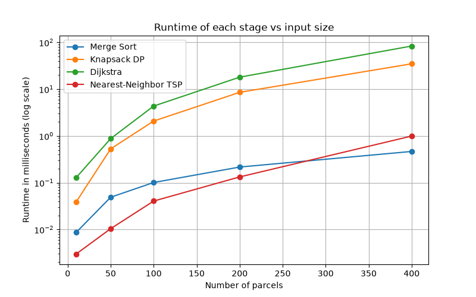
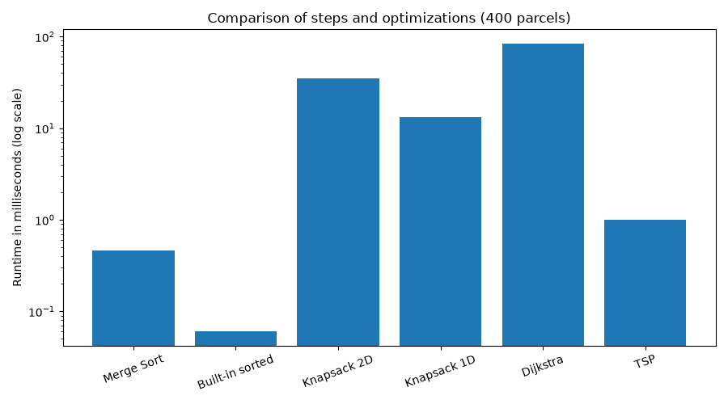
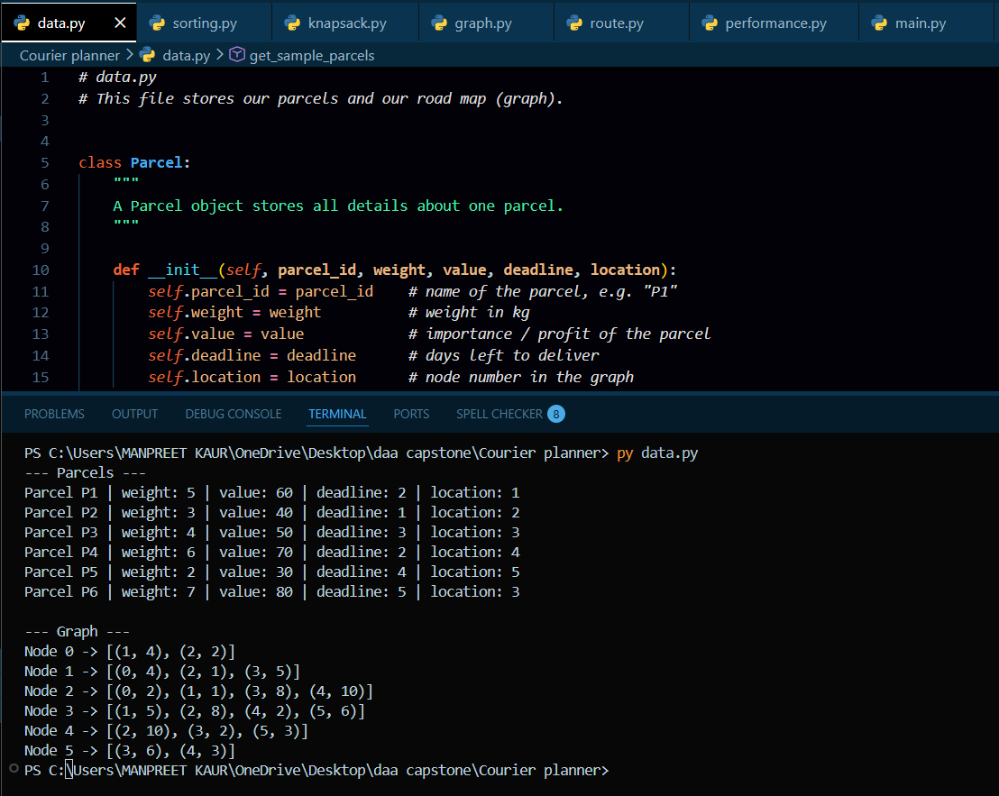
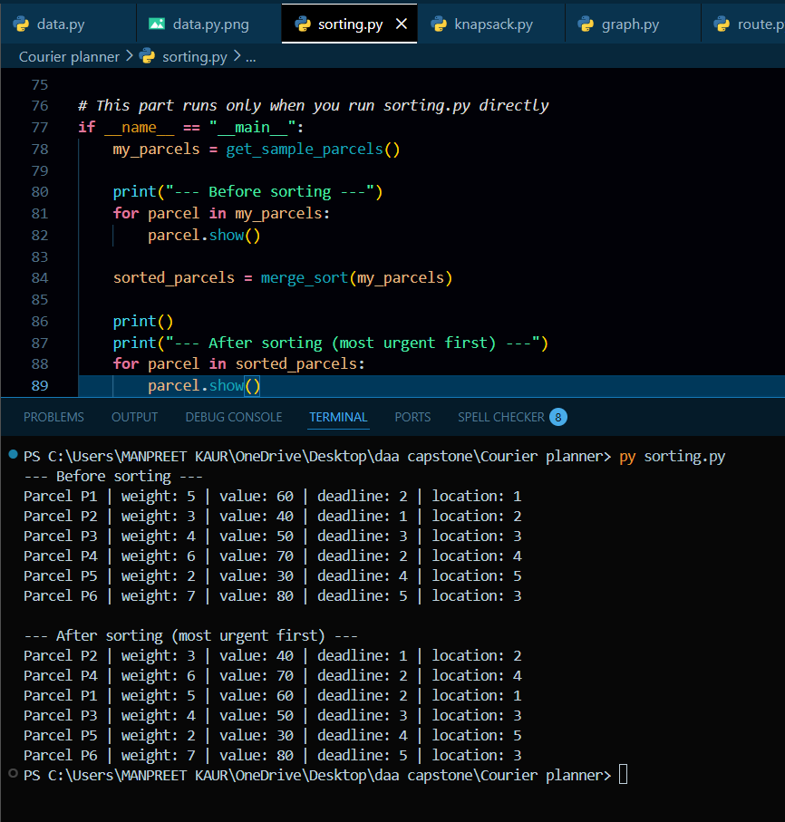
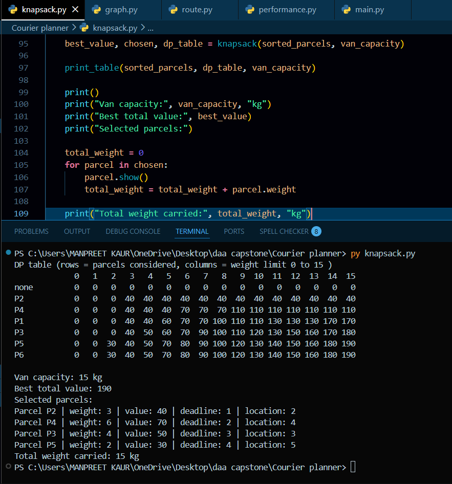
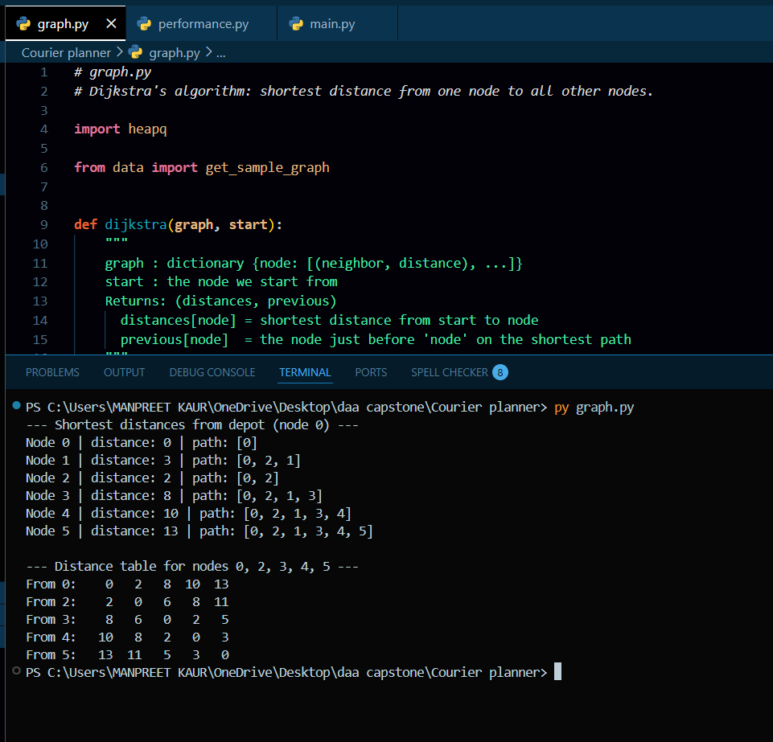
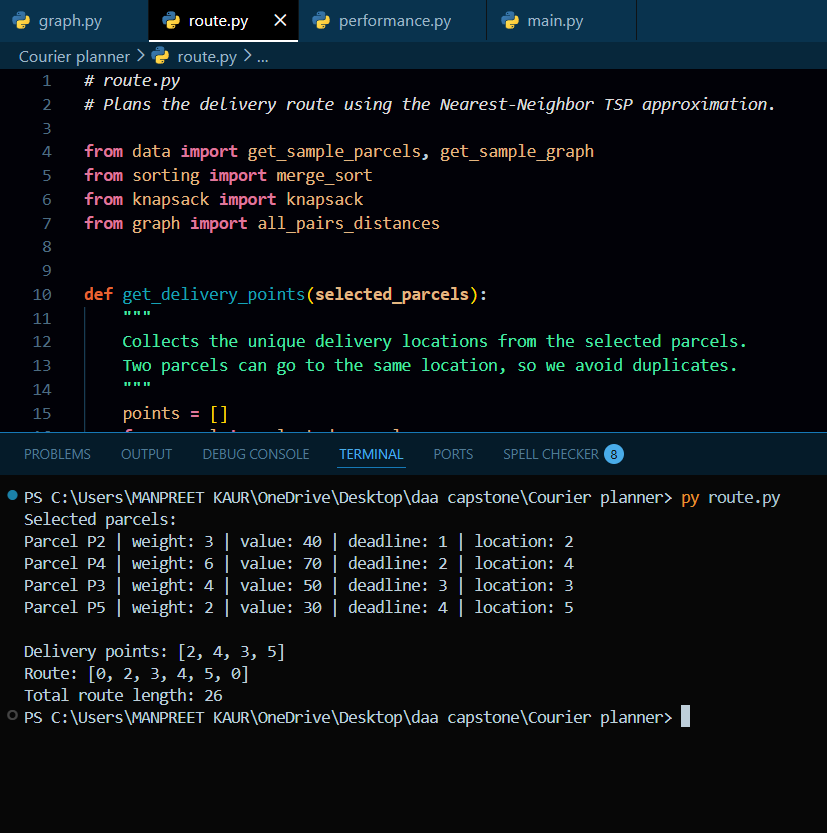
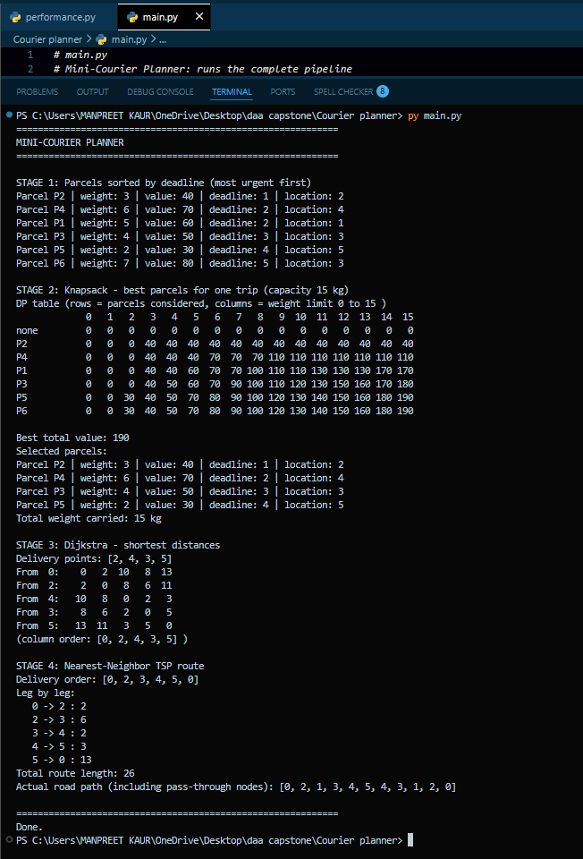
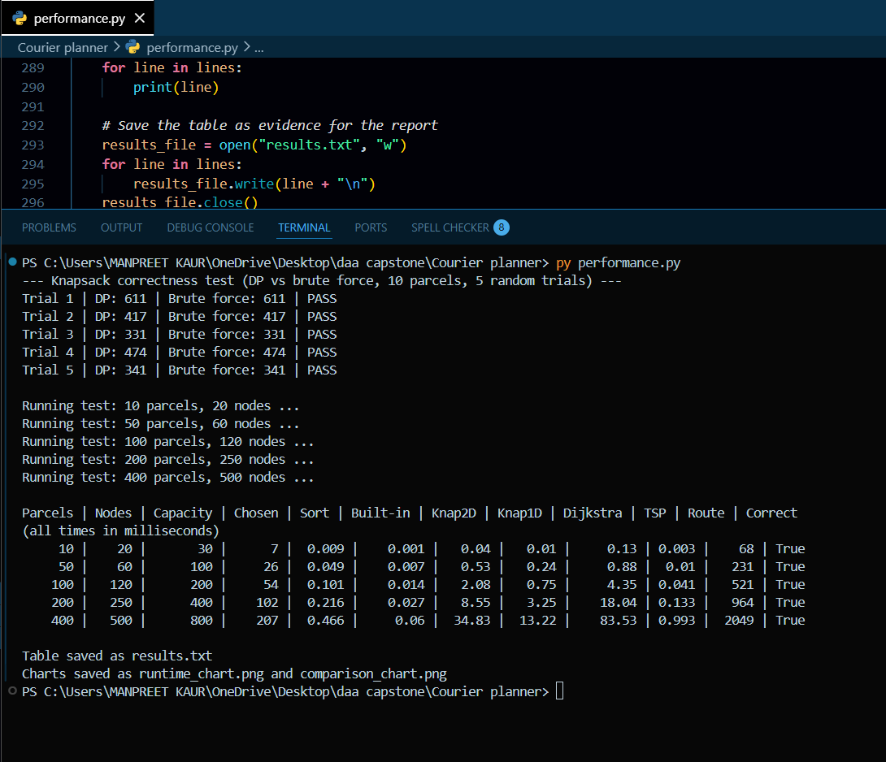

<div align="center">

# 🚚 Mini-Courier Planner

### An integrated algorithmic system for parcel prioritization, packing and route planning


-8A2BE2?style=for-the-badge)


</div>

---

## 👤 Project Details

| | |
|:--|:--|
| 🎓 **Student** | Manpreet Kaur |
| 🆔 **Roll No.** | 2501010070 |
| 📘 **Course** | Design & Analysis of Algorithms |
| 🏫 **University** | K.R. Mangalam University, Gurugram, Haryana |
| 💻 **Language** | Python 3 |

---

## ⚡ Results at a Glance

| 📦 Packing | ⚖️ Weight Used | 💰 Best Value | 🛣️ Route Length | ✅ Correctness |
|:--:|:--:|:--:|:--:|:--:|
| **P2, P4, P3, P5** | **15 / 15 kg** | **190** | **26** | **5/5 brute-force trials passed** |

---

## 📌 Problem Statement

> Given a list of parcels and delivery points, generate a **prioritized parcel list**, an **optimized packing plan** and an **ordered delivery route**, using **sorting, dynamic programming, graph algorithms and approximation**.

---

## 🎯 Phase 1: Design and Planning

### 🔄 System Flow

```
 Parcels
    │
    ▼
 [1] Merge Sort ───────────► most urgent parcels first
    │
    ▼
 [2] 0/1 Knapsack (DP) ────► best parcels for one van trip
    │
    ▼
 [3] Dijkstra ─────────────► shortest road distances
    │
    ▼
 [4] Nearest-Neighbor TSP ─► ordered delivery route
```

### 🧠 Algorithm Selection

| Stage | Algorithm | Time Complexity | Why this algorithm? |
|:--|:--|:--:|:--|
| 🔢 Prioritize | **Merge Sort** | `O(n log n)` | Stable; same speed in every case |
| 📦 Pack | **0/1 Knapsack (DP)** | `O(n × W)` | The van has a weight limit |
| 🗺️ Distances | **Dijkstra (heap)** | `O((V+E) log V)` | Real shortest road distances |
| 🛣️ Route | **Nearest-Neighbor** | `O(k²)` | Fast approximation of TSP |

### 🗂️ Data Design

| Item | Format |
|:--|:--|
| 📦 **Parcel** | `id`, `weight (kg)`, `value`, `deadline (days)`, `location (graph node)` |
| 🕸️ **Graph** | Adjacency list `{node: [(neighbor, distance), ...]}` |
| 🏠 **Depot** | Node `0` (roads are two-way) |
| 🧪 **Sample data** | 6 parcels (P1–P6), 6 nodes, 9 roads, van capacity **15 kg** (see `data.py`) |

---

## 📦 Phase 2: Prioritization and Box Filling

### 🔢 Sorting

- **Rule:** smaller deadline first; on a tie, higher value first.
- **Result:** `P2` → `P4` → `P1` → `P3` → `P5` → `P6`

### 🎒 Knapsack (Dynamic Programming)

- `table[i][w]` = best value using the first `i` parcels with weight limit `w`.
- Chosen parcels are found by **backtracking** from `table[n][capacity]`.

| Selected Parcels | Total Weight | Total Value |
|:--:|:--:|:--:|
| **P2, P4, P3, P5** | **15 kg** | **190** |

---

## 🗺️ Phase 3: Route Maker and Graph Processing

### 📍 Dijkstra: shortest distance from the depot

| Node | 1 | 2 | 3 | 4 | 5 |
|:--|:--:|:--:|:--:|:--:|:--:|
| **Distance** | 3 | 2 | 8 | 10 | 13 |

### 🛣️ Nearest-Neighbor TSP

Delivery points: `[2, 4, 3, 5]`

| Leg | 0 → 2 | 2 → 3 | 3 → 4 | 4 → 5 | 5 → 0 | **Total** |
|:--|:--:|:--:|:--:|:--:|:--:|:--:|
| **Distance** | 2 | 6 | 2 | 3 | 13 | **26** |

- 🚩 **Final route:** `0 → 2 → 3 → 4 → 5 → 0`
- 🧭 **Actual road path:** `[0, 2, 1, 3, 4, 5, 4, 3, 1, 2, 0]` (passes through node 1)

---

## ⏱️ Phase 4: Performance Testing and Optimization

Each stage was timed with `time.perf_counter()` (best of 3 runs). **All times in milliseconds.**

| Parcels | Merge Sort | Built-in sort | Knapsack 2D | Knapsack 1D | Dijkstra | TSP | Correct |
|:--:|:--:|:--:|:--:|:--:|:--:|:--:|:--:|
| 10 | 0.009 | 0.001 | 0.04 | 0.01 | 0.13 | 0.003 | ✅ |
| 50 | 0.049 | 0.007 | 0.53 | 0.24 | 0.88 | 0.010 | ✅ |
| 100 | 0.101 | 0.014 | 2.08 | 0.75 | 4.35 | 0.041 | ✅ |
| 200 | 0.216 | 0.027 | 8.55 | 3.25 | 18.04 | 0.133 | ✅ |
| **400** | **0.466** | **0.060** | **34.83** | **13.22** | **83.53** | **0.993** | ✅ |

### 📈 Runtime Charts

| Runtime of each stage vs input size | Comparison of steps (400 parcels) |
|:--:|:--:|
|  |  |

### ✅ Correctness Evidence

- 🧪 DP matched **brute force** in **5/5** random trials
- 🔢 Merge sort matched Python's `sorted()` in every test
- ⚖️ Van capacity was **never exceeded**
- 🛣️ Every route starts and ends at the depot and visits each stop exactly once

### 🔍 Key Findings

| Finding | Reason |
|:--|:--|
| ⚡ Built-in sort is about **8x faster** than merge sort | Implemented in C |
| ⚡ 1D knapsack is about **2.6x faster** than 2D | One row instead of a full table; space `O(W)` |
| 🐢 **Dijkstra is the slowest stage** | It runs once per delivery point |

### 🔧 Suggested Improvements

1. Use **1D knapsack** when only the best value is needed.
2. Use Python's **built-in sort** in production.
3. Run **Dijkstra** only when needed.
4. Improve the route with **2-opt**.
5. Raise the **value of urgent parcels** so deadlines are respected.

---

## 🏁 Phase 5: Result Explanation

> [!NOTE]
> **Why was P6 not chosen?** It has the highest value (80) but the lowest value per kg (about 11.4). Knapsack picks the best *combination*, and P2, P4, P3, P5 fill exactly 15 kg for 190.

> [!NOTE]
> **Why does the route return to the depot?** The route is a closed tour: the van starts and ends at the depot.

> [!NOTE]
> **Why is nearest-neighbor only an approximation?** Greedy choices can leave a long trip back; here the last leg `5 → 0` costs 13.

> [!WARNING]
> **Limitation:** knapsack maximizes value, not deadlines, so an urgent parcel (like P1) can be left out.

### 📸 Screenshot Evidence

<details>
<summary><b>Click to view all output screenshots</b></summary>

<br>

| Stage | Screenshot |
|:--|:--:|
| 🗂️ Data |  |
| 🔢 Sorting |  |
| 🎒 Knapsack |  |
| 📍 Dijkstra |  |
| 🛣️ Route |  |
| 🚚 Full program |  |
| ⏱️ Performance |  |

</details>

---

## 📁 Project Files

| File | Purpose |
|:--|:--|
| 📄 `data.py` | Parcel class, sample parcels and graph |
| 📄 `sorting.py` | Merge Sort by deadline |
| 📄 `knapsack.py` | 0/1 Knapsack with DP table |
| 📄 `graph.py` | Dijkstra and path building |
| 📄 `route.py` | Nearest-Neighbor TSP route |
| 📄 `main.py` | Runs the complete pipeline |
| 📄 `performance.py` | Tests, correctness checks, timings, charts |
| 📊 `results.txt` | Saved runtime table |
| 🖼️ `runtime_chart.png`, `comparison_chart.png` | Runtime charts |
| 📸 `screenshots/` | Output screenshots |

---

## ▶️ How to Run

**1️⃣ Install Python 3** (tick "Add to PATH") and **matplotlib**:

```bash
py -m pip install matplotlib
```

**2️⃣ Run the full courier planner:**

```bash
py main.py
```

**3️⃣ Run tests, timings and charts:**

```bash
py performance.py
```

> 💡 On Windows, use `py` if `python` is not recognized.

---

<div align="center">

**Made with ❤️ by Manpreet Kaur · DAA Capstone Assignment**

</div>
